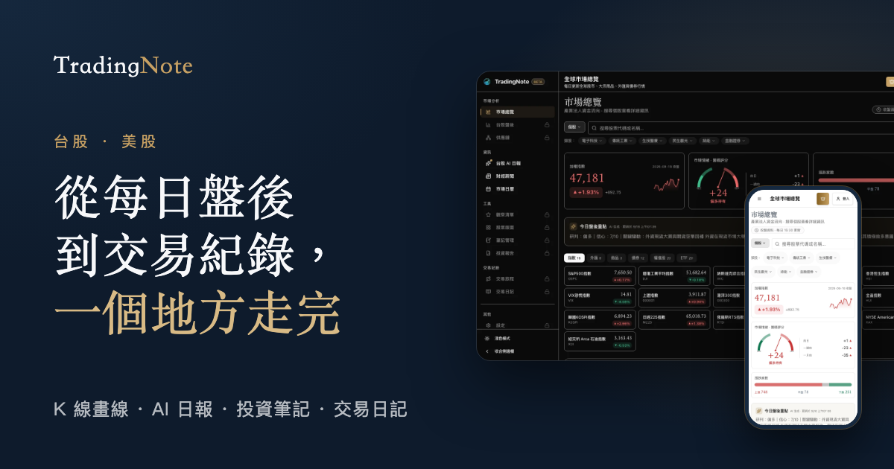

# TradingNote

台美股看盤、AI 日報、投資筆記與交易紀錄，從研究到紀錄一個地方完成。

[網站](https://www.tradingnote.tw) · [使用說明](https://www.tradingnote.tw/help) · [方案與定價](https://www.tradingnote.tw/pricing) · [LINE 官方帳號](https://line.me/R/ti/p/@613hozli)

## 產品

- 台股盤後與總經評分：每個交易日 15:30 更新三大法人、外資期貨、選擇權 PCR、台灣 VIX 等指標，並彙整成一個總經評分。
- 台股 AI 日報：每天由 Gemini 依當日盤後資料產生大盤結論、外資動向與風險情境；另有總經新聞解讀與社群市場情緒觀察。
- K 線圖與版面：台美股技術指標、畫線標註、多股比較，版面可儲存；新聞可連結到個股，看圖時對照當天事件。
- 筆記、投資報告與交易紀錄：筆記可附圖片與 PDF，報告可分享或匯出 PDF，交易旅程與交易日記記錄每筆交易的進出與復盤。
- 其他：市場總覽、供應鏈流向圖、觀察清單、股票農民曆與財經行事曆。

主要程式碼為私人 repo。

## 團隊

- [Aaron](https://github.com/eepson123tw) — 前端
- [YF](https://github.com/YFCKevin) — 後端

2025 Q2 開始開發，2025 Q4 上線，持續開發中。

---

本服務內容僅供參考，不構成投資建議，詳見[非投資建議聲明](https://www.tradingnote.tw/disclaimer)。
